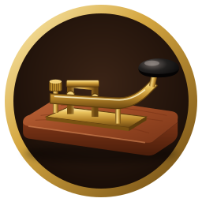
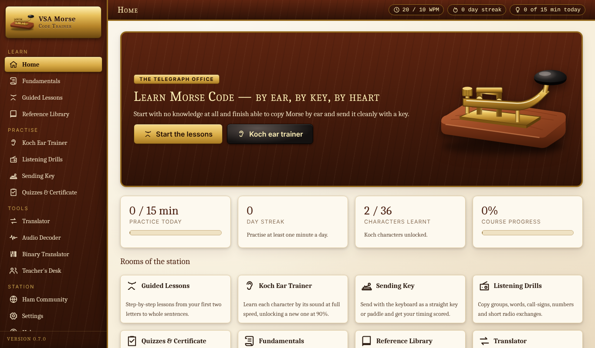
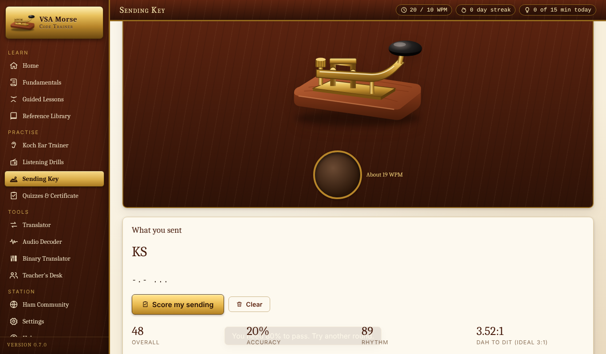
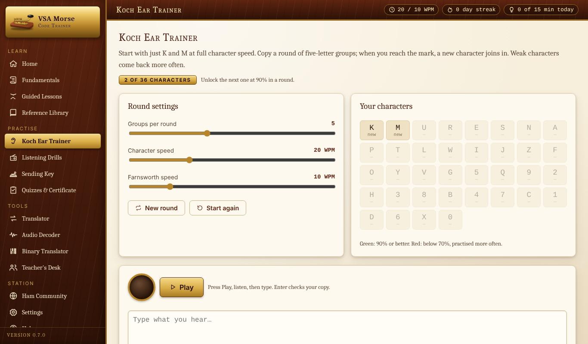
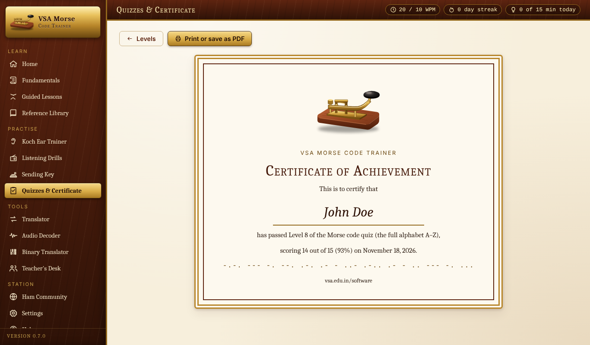
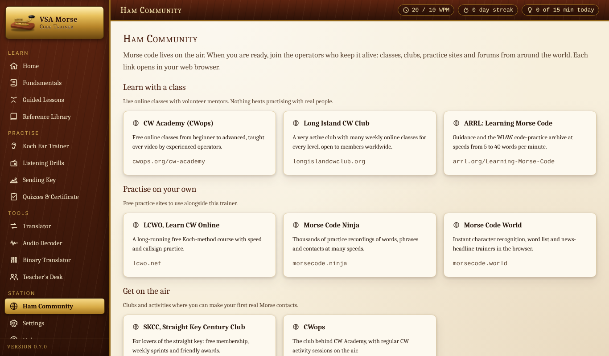

<p align="center">
  
</p>

# VSA Morse Code Trainer

> **Learn Morse Code — by ear, by key, by heart.**

A free, open-source, offline Windows desktop application that teaches Morse code (CW) completely, not just a translator. A student can start with zero knowledge and finish able to copy Morse by ear and send it cleanly with a key. A teacher can follow a whole class offline.

It was written by a licensed radio amateur as a gift to the ham community: to help new operators learn the code and to point them to the clubs and classes that keep CW alive on the air.

The look and feel follow an old telegraph office: a polished brass straight key on a mahogany base, aged telegram paper and brass nameplates.

> **Get it free from the [Microsoft Store](https://apps.microsoft.com/detail/9nbp8jk9jp5m).** Version 0.7.2. Free for everyone, with no ads and no accounts.

<p align="center">
  
</p>

---

## Developers

- **Developed by:** Prof. Dattaraj S. Vidyasagar & Prof. Yash D. Vidyasagar, for Vidyasagar Academy.
- **Website:** [https://vsa.edu.in/software/](https://vsa.edu.in/software/)
- **Inquiries & support:** [softinquiry@vsa.edu.in](mailto:softinquiry@vsa.edu.in)
- **License:** GNU General Public License v3.0 (GPL-3.0) — see [LICENSE](LICENSE)

---

## Features

- **Reference library** — ITU-R M.1677 letters, numerals, punctuation, prosigns, Q-codes and abbreviations, each with an audible rhythm preview, plus a printable chart.
- **Fundamentals course** — ten illustrated chapters: the 1-3-7 timing rule, the standard word "PARIS", Farnsworth spacing, prosigns, operating etiquette and telegraph history, with chapter quizzes.
- **Koch-method ear trainer** — characters at full speed (default 20 WPM) with Farnsworth spacing, a 36-character mastery grid and automatic unlocking at 90% accuracy.
- **Sending practice** — straight key and iambic paddle on the keyboard, live sidetone, timing analysis, dash-to-dot ratio scoring and coaching tips.
- **Listening drills** — random groups, words, call-signs, numbers and simulated radio contacts (QSOs).
- **Quizzes and certificate** — levels from four letters up to the full alphabet, several question formats, and a printable completion certificate.
- **Translator** — text to Morse and back as you type, audio playback, loop, screen-flash signal lamp and WAV download.
- **Audio file decoder** — open a WAV recording of Morse and decode it on your own computer.
- **Binary translator** — text to 8-bit binary and back, for comparing two classic encodings.
- **Teacher's desk** — offline class roster, CSV export and printable practice sheets with an answer key.
- **Ham community** — hand-picked links to CW classes, practice sites, clubs, national societies and forums, opened in your browser.
- **Offline and private** — no internet connection, no accounts, no tracking. See the [Privacy Policy](privacy-policy.md).

---

## Technology

| Part            | Technology                                    |
| --------------- | --------------------------------------------- |
| Desktop shell   | Tauri 2, using Windows' built-in WebView2     |
| Back end        | Rust (all file, audio-file and data work)     |
| Front end       | TypeScript (strict), plain HTML and CSS, Vite |
| Sound           | Web Audio API with click-free 5 ms envelopes  |
| Data storage    | JSON files in the app data folder             |
| Package manager | pnpm                                          |
| Installer       | NSIS installer plus a portable EXE            |

---

## Building from source (Windows)

Requirements: Node.js 20 or newer with pnpm (`corepack enable`), Rust (stable, MSVC), and the Visual Studio C++ Build Tools.

```bat
git clone https://github.com/dsvakola/VSA-Morse-Code-Trainer.git
cd VSA-Morse-Code-Trainer
build.bat
```

`build.bat` runs `pnpm install` and `pnpm tauri build`, then places the portable EXE, the installer and the Microsoft Store package (MSIX, when the Windows SDK is installed) in the `Release` folder.

For development: `pnpm tauri dev`. Tests: `pnpm test` and `cargo test`.

---

## Screenshots

| Sending key                                      | Koch ear trainer                                 |
| ------------------------------------------------ | ------------------------------------------------ |
|  |    |
| **Quiz certificate**                             | **Ham community**                                |
|  |  |

---

## Ham community

Learning Morse is more fun with other operators. Good places to start:

- **CW Academy (CWops):** <https://cwops.org/cw-academy/>
- **Long Island CW Club:** <https://longislandcwclub.org/>
- **LCWO, Learn CW Online:** <https://lcwo.net/>
- **Morse Code Ninja:** <https://morsecode.ninja/>
- **SKCC, Straight Key Century Club:** <https://www.skccgroup.com/>
- **IARU member societies (find your national society):** <https://www.iaru.org/about-us/organisation-and-history/member-societies/>
- **QRZ.com forums:** <https://forums.qrz.com/>

## Related resources

- **ITU-R M.1677 Recommendation:** <https://www.itu.int/rec/R-REC-M.1677/en>

## Contributing

Issues and pull requests are welcome, especially from CW instructors and clubs: new drills, word lists, translations and teaching methods. Please open an issue first to discuss larger changes.

---

## Safety note

Morse and SOS practice in this software is for education only. In a real emergency, always use official emergency services.

---

## License

This program is free software: you can redistribute it and/or modify it under the terms of the **GNU General Public License v3.0 (GPL-3.0)** as published by the Free Software Foundation. See [LICENSE](LICENSE) for the complete terms.

Copyright © 2026 Prof. Dattaraj S. Vidyasagar & Prof. Yash D. Vidyasagar, Vidyasagar Academy.
