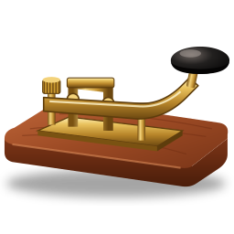

<p align="center">
  
</p>

# VSA Morse Code Trainer

> **Learn Morse Code — by ear, by key, by heart.**

A free, offline Windows desktop application that teaches the full details of Morse code — not just a translator. A student can start with zero knowledge and finish able to copy Morse by ear and send it accurately by key. A teacher can follow a whole class offline.

The look and feel follow an old telegraph office: rusted iron, burnished brass, walnut and aged telegram paper, with the straight telegraph key at its heart.

> **Status:** under active development (version 0.5.1). The first public release will be announced on the Vidyasagar Academy website.

---

## Developers

- **Developed by:** Prof. Dattaraj S. Vidyasagar & Prof. Yash D. Vidyasagar, for Vidyasagar Academy.
- **Website:** [https://vsa.edu.in/software/](https://vsa.edu.in/software/)
- **Inquiries & support:** [softinquiry@vsa.edu.in](mailto:softinquiry@vsa.edu.in)
- **License:** GNU General Public License v3.0 (GPL-3.0) — see [LICENSE](LICENSE)

---

## Features

- **Reference library** — ITU-R M.1677 letters, numerals, punctuation, prosigns, Q-codes and abbreviations, each with an audible rhythm preview, plus a printable chart.
- **Fundamentals course** — ten illustrated chapters: the 1-3-7 timing rule, the standard word "PARIS", Farnsworth spacing, prosigns, operating etiquette and telegraph history, with chapter quizzes.
- **Koch-method ear trainer** — characters at full speed (default 20 WPM) with Farnsworth spacing, a 36-character mastery grid and automatic unlocking at 90% accuracy.
- **Sending practice** — straight key and iambic paddle on the keyboard, live sidetone, timing analysis, dash-to-dot ratio scoring and coaching tips.
- **Listening drills** — random groups, words, call-signs, numbers and simulated radio contacts (QSOs).
- **Quizzes and certificate** — levels from four letters up to the full alphabet, several question formats, and a printable completion certificate.
- **Translator** — text to Morse and back as you type, audio playback, loop, screen-flash signal lamp and WAV download.
- **Audio file decoder** — open a WAV recording of Morse and decode it on your own computer.
- **Binary translator** — text to 8-bit binary and back, for comparing two classic encodings.
- **Teacher dashboard** — offline class roster, student progress and CSV reports.
- **Offline and private** — no internet connection, no accounts, no tracking. See the [Privacy Policy](privacy-policy.md).

---

## Technology

| Part            | Technology                                    |
| --------------- | --------------------------------------------- |
| Desktop shell   | Tauri 2, using Windows' built-in WebView2     |
| Back end        | Rust (all file, audio-file and data work)     |
| Front end       | TypeScript (strict), plain HTML and CSS, Vite |
| Sound           | Web Audio API with click-free 5 ms envelopes  |
| Data storage    | JSON files in the app data folder             |
| Package manager | pnpm                                          |
| Installer       | NSIS installer plus a portable EXE            |

---

## Building from source (Windows)

Requirements: Node.js 20 or newer with pnpm (`corepack enable`), Rust (stable, MSVC), and the Visual Studio C++ Build Tools.

```bat
git clone https://github.com/dsvakola/VSA-Morse-Code-Trainer.git
cd VSA-Morse-Code-Trainer
build.bat
```

`build.bat` runs `pnpm install` and `pnpm tauri build`, then places the portable EXE and the installer in the `Release` folder.

For development: `pnpm tauri dev`. Tests: `pnpm test` and `cargo test`.

---

## Related resources

- **Morse Code Translator & Trainer by Mudassir Hussain:** [https://www.morsecodetranslater.com/](https://www.morsecodetranslater.com/)
- **Vidyasagar Academy Arduino Morse project:** [https://vsa.edu.in/convert-text-into-morse-code-with-beeps-back-into-text-with-arduino/](https://vsa.edu.in/convert-text-into-morse-code-with-beeps-back-into-text-with-arduino/)
- **ITU-R M.1677 Recommendation:** [https://www.itu.int/rec/R-REC-M.1677/en](https://www.itu.int/rec/R-REC-M.1677/en)
- **ARRL (American Radio Relay League):** [https://www.arrl.org/](https://www.arrl.org/)
- **CWops CW Academy:** [https://cwops.org/cw-academy/](https://cwops.org/cw-academy/)
- **LCWO (Learn CW Online):** [https://lcwo.net/](https://lcwo.net/)

---

## Safety note

Morse and SOS practice in this software is for education only. In a real emergency, always use official emergency services.

---

## License

This program is free software: you can redistribute it and/or modify it under the terms of the **GNU General Public License v3.0 (GPL-3.0)** as published by the Free Software Foundation. See [LICENSE](LICENSE) for the complete terms.

Copyright © 2026 Prof. Dattaraj S. Vidyasagar & Prof. Yash D. Vidyasagar, Vidyasagar Academy.
